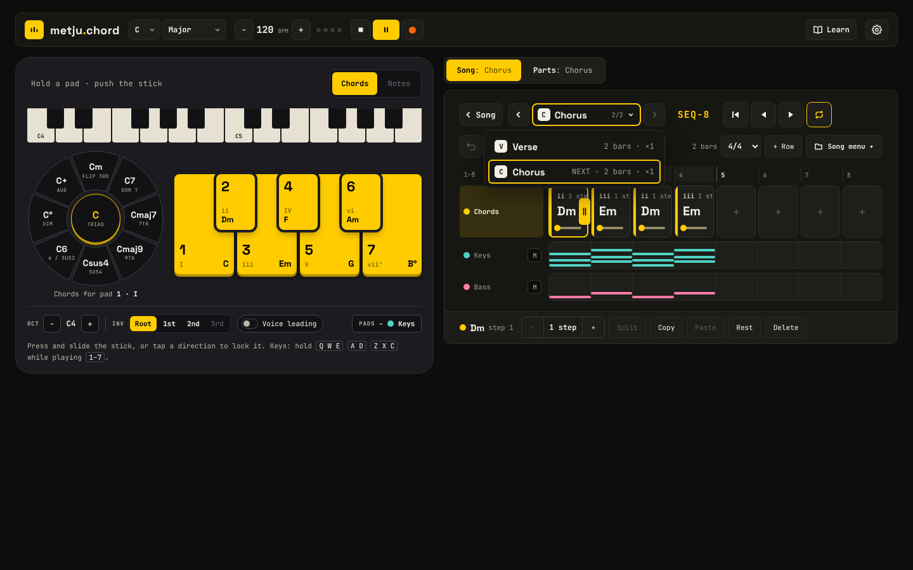
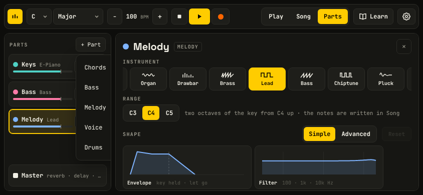
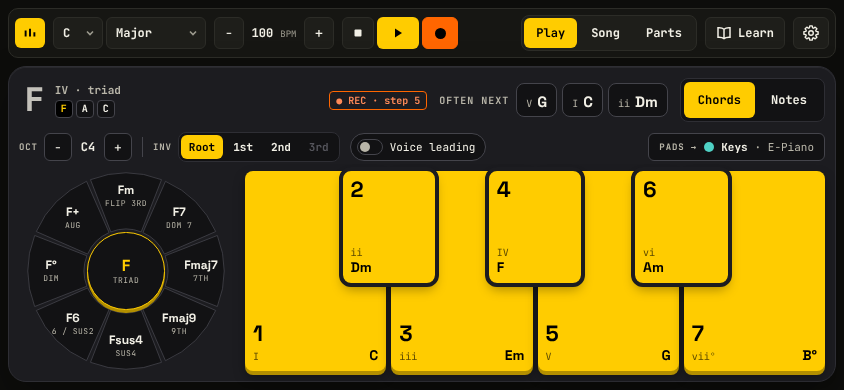
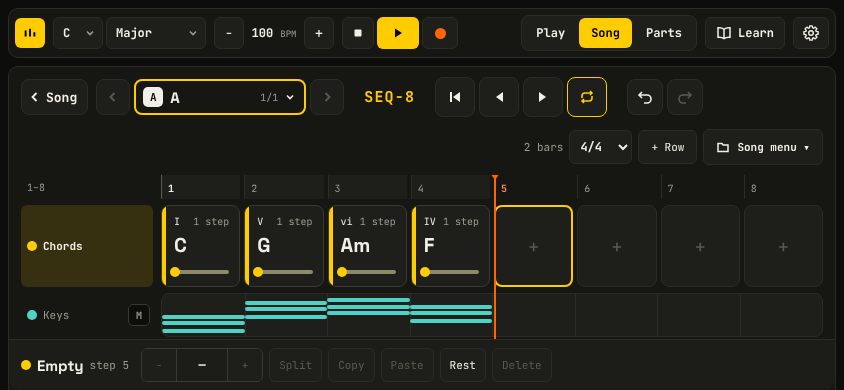
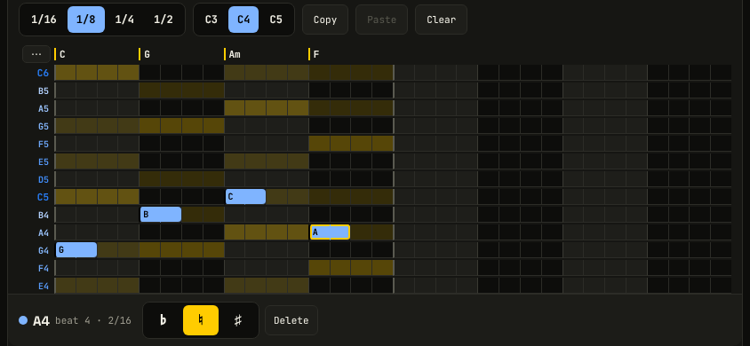
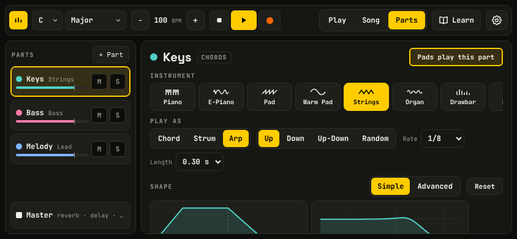
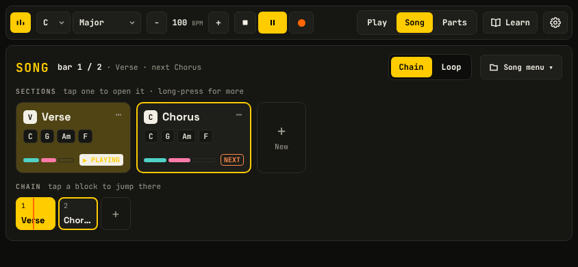
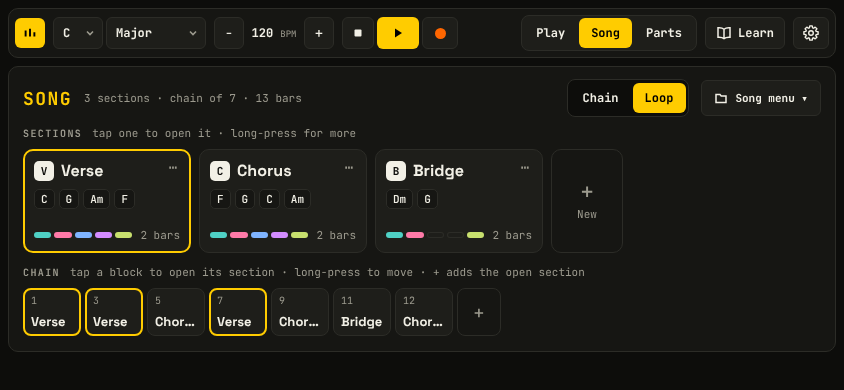
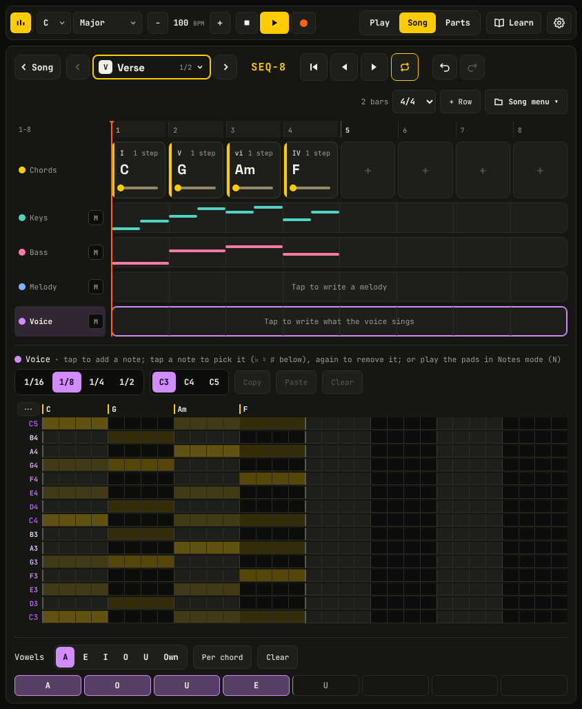
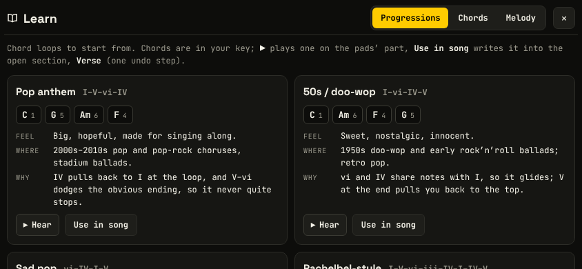

# Metju.Chord: product and code review

Reviewed at `f3b3804` (v1.50.0), 10 November 2026. Nothing in the app was changed; this folder is the only addition.

**How it was checked.** `npm ci`, `npm test` (308 tests pass, 2.4 s), `npm run build` (17.6 s, one warning: the bundle is 857 KiB against the 781 KiB limit set in `webpack.config.js`), `npm run levels` (green: RMS spread 5.3 dB, 31 s). The built app was driven with Playwright at 1440×900, 1280×720, 1024×768, 390×844 and 844×390, in both themes, with touch on the phone and tablet sizes. **The phone layout is landscape only** (the owner's correction after the first pass), so the 390×844 findings have been removed and every phone finding below is for 844×390. The save readers were fuzzed with 20,000 mutated saves. **I could not hear anything**: every statement about sound is based on what the app schedules on the audio graph (recorded by wrapping `AudioParam` methods) and on `npm run levels`. Real-phone feel, iOS behaviour and speakers were not checked.

Effort: **S** up to half a day, **M** one to three days, **L** a week or more. Confidence is stated where it is not high.

**Status.** The first block of the plan (section 6, items 1 to 8) is done on this branch: bugs 1, 2, 3, 4, 6, 7, 8, 9, 10 and 11 are fixed, as are suspected 14 and 17, and the pads now play on Enter (3.9). Bug 5 (the 100 ms look-ahead) and suspected 12, 13, 15 and 16 are open. The text below describes the app as reviewed.

---

## 1. Summary

**The product.** This is a well-made, coherent instrument. The pads-and-stick idea is clear within seconds, the visual language is consistent across every screen and both themes, there was not a single console error or horizontal overflow at any of the five sizes, and text contrast passes WCAG AA almost everywhere. Learn is the best on-ramp in the app: one tap on "Use in song" gives a four-bar loop that plays. The save readers are robust: no mutated save made them throw.

The weak side is the phone, which is the stated priority. The layout is a desktop layout made narrower rather than one designed for a thumb: almost every control outside the pads is 22 to 36 px, the melody grid's cells are 24×18 px, the top bar (the only transport) scrolls away, and a section with an editor open is more than two screens tall (842 to 883 px in a 390 px window), so editing means scrolling a page inside which other things scroll. Section 3.12 compares this with similar apps. The second weakness is the "Song vs Parts, section vs whole song" model: on a phone nothing tells you whether Parts is editing one section or the whole song, and undo exists on only one of the four screens although every notice says "Undo to…".

**The code.** The pure modules (`theory`, `parts`, `sections`, `song`, `playback`, `strum`, `learn`) are clean, documented and well tested. The cost is concentrated in three places: `App.tsx` (2,016 lines, 54 `useState`, 22 refs, 20 effects) which re-renders the whole tree on every 1/16 of playback with no memoised component anywhere; the content handling for notes, drums and vowels, which is spread over about ten functions and has already drifted; and the audio engine, which keeps every strip's effects running whether used or not and has two scheduling bugs. There are no tests above the pure layer, and the two worst bugs found here (the section switch that never lands, the share link that overwrites your song) both live there.

### The 5 changes that would help users most

1. **Fix the queued section switch in Loop mode** (bug 1). With a one-bar loop, which is what recording four chords gives you, switching section while playing never happens.
2. **Stop a share link from overwriting the saved song** (bug 2), and show its notice after the intro.
3. **No page scroll on the phone.** A fixed one-row top bar with undo/redo in it, and a lane's editor that opens full height instead of under the lane list (3.12).
4. **Touch sizes and chord entry**: a melody grid you can hit (one octave at about 36 px a row), 44 px for the top bar, M/S, octave and chip buttons, and chords placed from Song by tapping one of the key's seven (one bar long).
5. **Say where Parts edits go on a phone** ("Editing: Chorus only" / "Whole song", with a way back to the song's sound), and cut the live pads' built-in 100 ms delay (bug 5).

### The 5 changes that would help the codebase most

1. **Move the playhead out of React state** (a small transport store read by the few components that need it), then `React.memo` the editors. This removes the per-1/16 re-render of everything.
2. **Split `App.tsx` along its existing seams** into hooks: settings, song document, transport, pads, preview, metronome, keyboard (section 5.1 has the cut lines).
3. **One table for part content** (notes, drums, vowels) used by `fill`, `stripContent`, `contentOf`, `sameContent`, the readers, `fitTo`, time-signature change and `partEnd`.
4. **Six browser tests in CI** (section 5.7). They would have caught bugs 1, 2, 4 and 8.
5. **ESLint with `react-hooks`, plus `tsc --noEmit` and `npm run levels` in CI.** The code already carries eleven `eslint-disable` comments for a linter that is not installed.

---

## 2. Bugs

Confirmed bugs were reproduced in the built app or in a script against the source. "Suspected" means read in the code, not run.

### Confirmed

**1. Loop mode: a section switch queued for the loop's end never lands.** High.
Steps: two sections, the first with one bar of chords. Loop mode, open the first section, Play, press › (next section). Expected: the next section starts at the bar line. Actual: "NEXT" stays on it for good and the first section keeps looping (checked for 10 s; bass roots heard were `C G A F` repeating). With a two-bar loop the switch works when pressed in bar 1 and fails when pressed in bar 2 (roots `C G C G…`).

Cause: `src/audio/sequencer.ts:142-145`. A jump at or past the loop end is clamped to `loopEnd`, and the test is `at >= from && at < to`. The loop end is always a multiple of the 1/16 window, so the last window is `[loopEnd - 24, loopEnd)`, which excludes it, and the next pass wraps `from` to 0 (`:124`). Fix: treat a jump at the loop end as due in the window that reaches it.
```ts
const atEnd = opts.loop && jump.at >= opts.loopEnd;
const at = atEnd ? opts.loopEnd : jump.at;
if (at >= from && (at < to || (atEnd && to >= opts.loopEnd))) { … }
```
Effort S, risk low. `SequencerPlayer` has no test; it needs a fake Transport (5.7).

**2. Opening a share link replaces your saved song before you tap Start, and the notice is never seen.** High (data loss).
Steps: have a song (77 BPM). Open a `#song=` link to another (133 BPM). Without touching anything, `localStorage` holds the shared song 1.2 s later. Tap Start: no notice. Reload: 133 BPM; your song is gone, because undo history is not saved.
Cause: `src/App.tsx:1208-1220` loads the link on mount through `loadState`, the autosave effect (`:1172-1182`) writes it 400 ms later, and the "Opened the shared song. Undo to go back to yours." notice (`:1214`) expires after 2.6 s while only the intro is mounted (`:1529`).
Fix: don't autosave a shared song until the user's first edit or an explicit "Keep this song"; keep the previous song under a second key (`metju.chord.v3.before-share`) with a "Back to my song" button; show the notice after the intro. Effort S to M, risk low.

**3. Voice: every sequenced note is cut dead at its end; the release never sounds.** Medium to high for anyone using Voice.
Measured on one sung note during playback (attack at 2.843 s, end at 3.328 s, release 0.7 s): the calls on the singer's gain are `setTargetAtTime(0.245, 2.963)` … then `setValueAtTime(0, 3.328)`. The gain jumps to zero.
Cause: `src/audio/voice.ts:201-205`. `end()` does `p.setValueAtTime(p.value, at)`. `p.value` is the value *now*; the sequencer calls `attack` and `release` together, ahead of time, when the gain is still 0. Live pads are fine because their release is called later. The default 35% reverb send hides part of it. Fix: drop that line (a `setTargetAtTime` continues from wherever the envelope is), or use `cancelAndHoldAtTime(at)` as `SamplePlayer.release` already does (`instruments.ts:436`). Effort S, risk low, re-run `npm run levels`. I could not listen to the result.

**4. Space on a focused button starts playback instead of pressing the button.** Medium (keyboard and assistive-tech users).
Steps: Tab to the "Parts" tab, press Space. Expected: Parts opens. Actual: the song starts and the tab stays unselected. Enter works.
Cause: the global handler (`src/App.tsx:1396`) takes Space with `preventDefault` whenever the target is not an input, select or slider (`:1351-1353`). Fix: let Space, Enter and the arrow keys through when the target is a `button`, `[role=tab]`, `[role=gridcell]` or `[role=menuitem]`. Effort S.

**5. Every live pad press is scheduled about 100 ms late.** Medium to high for feel; the latency itself is confirmed, its audible effect is not.
Measured: on a pad press the note's audio events are scheduled 0.097 s after the audio clock's "now". Handling is fast (touch to audio call 2 ms; 6 to 10 ms at 4× and 6× CPU throttle), so this delay is nearly all of the latency.
Cause: `Engine.attack` uses `Tone.now()` (`src/audio/engine.ts:446`), which is `currentTime + lookAhead`, and Tone's default look-ahead is 0.1 s. Fix: use `Tone.immediate()` for live attacks, releases and drum auditions (`:352`, `:443-457`); keep `Tone.now()` for anything on the Transport. Effort S, risk medium: check for clicks on a real phone, and check live recording, which stamps notes at press time while the player hears them 100 ms later (suspected bug 12).

**6. Notes mode pads ignore a section's own sound.** Medium.
Steps: open a section whose Melody is set to Piano while the song's is Lead. Tapping a cell in the grid starts a sample (correct). Pressing a pad in Notes mode starts a synth oscillator at C4, which only the song-wide Lead strip has.
Cause: `src/App.tsx:449` passes `s.padMelody.id`; it should be `trackOf(s.padMelody.id)` as `auditionNote` does (`:1013`). Effort S.

**7. "+ Part" menu is cut off on phones.** Low to medium.
On 844×390 the menu opens inside the Parts list, whose overflow clips it: the hints ("plays the chords", "follows the roots"…) are cut and it overlaps the list.

Cause: `AddPartMenu` (`src/components/PartsView.tsx:261-299`) is an absolutely positioned popover; `AddEffectMenu` next to it already uses the fixed `PopMenu` for exactly this reason (`:311`). Effort S.

**8. A voice switched back from Notes to Chords still stretches the section.** Medium.
A voice with a note at beat 13, set to sing chords, over four beats of chords: `musicEnd` returns 1248 ticks instead of 384, so the loop and the chain slot are 3 bars too long and silent.
Cause: `partEnd` in `src/parts.ts:652-655` uses `hasNotes` where `writesNotes` is meant. Effort S.

**9. Clicking what is already selected adds an undo step that does nothing.** Low.
Fresh song, Parts: tap the selected instrument and the selected play mode. Undo becomes available and undoes nothing.
Cause: `applySectionEdit` always returns a new object (`src/sections.ts:179-188`), so `useHistory` never sees `next === cur.present` (`src/useHistory.ts:27`). Fix: return `song` when parts, sections and the song-wide fields are all identical. Effort S.

**10. A Voice part with notes or vowels gets a new object on every edit of anything.** Low (it only defeats memoisation today).
`applySectionEdit(f, id, sectionView(f, id))` keeps `parts` for melody and drums but not for a voice with content.
Cause: `shallowEqual(old, next, ['notes', 'drums'])` in `src/sections.ts:147` leaves out `'vowels'`. This is the content drift described in 5.2. Effort S.

**11. "Vowel glide" overflows its knob tile.** Low, visual. See `shots/parts-voice-landscape.png` and `shots/parts-tablet.png`: the label is wider than the tile and runs into its neighbours. Shorten to "Glide" under a "Vowel" heading, or let the tile grow. Effort S.

### Suspected (read, not run)

12. **Live recording lands early.** `pressPad` stamps a live note at `player.position()` at press time (`App.tsx:504-507`) while the sound comes 100 ms later (bug 5). At 120 BPM a 1/16 is 125 ms, so a player who plays to what they hear can land one cell early. Fixing bug 5 mostly removes it.
13. **Voice notes leak nodes.** Each note connects the singer's vibrato and drift LFOs to its oscillator's `detune` (`voice.ts:161-162`) and never disconnects them; the cleanup at `:212-217` only disconnects the oscillator's output. A stopped oscillator still referenced by a running LFO may not be collected. A long session with a choir would show it in a heap snapshot.
14. **Drum audition ignores the section's strip**: `auditionDrum` uses `drumPart.id` (`App.tsx:979`), not `trackOf`. Same class as bug 6.
15. **A no-op edit inside a knob drag loses an undo step.** In `useHistory.commit` the merge decision is made before the updater runs (`useHistory.ts:22-24`). If the first commit of a merge key changes nothing and the second does, the second merges into the step before the drag.
16. **Dragging Reverb size re-renders the impulse response on every pointer move**: `this.reverb.decay = …` in `engine.ts:272` regenerates it offline each time. Likely a stutter on phones.
17. **Crafted saves**: a part id is any string (`song.ts:415`). `"__proto__"` makes that part's content unstorable (confirmed: the content is dropped), and `"p1@s1"` collides with a strip id (confirmed: `engineStrips` lists `p1@s1` twice). Harmless today, but ids should be limited to `/^[A-Za-z0-9_-]{1,24}$/`. `decodeShare` (`song.ts:665-669`) inflates a link with no size limit; a small crafted link can exhaust memory. Cap the output (say 2 MB).

---

## 3. Product findings

### 3.1 First visit: intro → first chord → a 4-chord loop

Good: the intro is a real moment, the first pad plays at once, the chord info and "Often next" teach without a tutorial, and Record from Play mode works with a clear `● REC · step 5` tag.



| # | What I saw | Why it matters | Suggestion | Effort |
| --- | --- | --- | --- | --- |
| P1 | Recording gives one chord per beat. C–G–Am–F becomes a one-bar loop at 100 BPM. Lengthening a chord with `+` overwrites the next one (`setLength` → `place`, by reading). | The most common loop is one chord per bar. A new user's first loop sounds rushed and can't be stretched without re-recording. | A "Chord length" choice next to REC: **1 beat · 2 beats · 1 bar** (default 1 bar), remembered. Separately, make `+` on a chord push the following chords along when there is room. | S + M |
| P2 | Nothing on the Play screen says how to make a loop. The prompt is "Hold a pad · push the stick"; the red dot is unlabeled. | The step from "instrument" to "song" is the app's main idea and it is a guess. | When the chord row is empty, after the first few pad presses show one line under the chord info: "● Record, then play pads to write a loop". Remove it once a chord exists. | S |
| P3 | Tapping **Song** on a first visit shows one tile "A · no chords yet" and a chain of one. The chord row is a tap further in. | An extra tap and a moment of "where do I put chords?" on the first try. | With one section, open it directly; show the overview once there are two. Or put "+ Record chords" on the empty tile. | S |
| P5 | Play is always yellow, also when stopped. | "Yellow means active" is the app's rule; Play reads as on. | Neutral when stopped, yellow while playing. | S |

### 3.2 Building a song: bass, drums, melody, recording

Good: bass and melody are there from the start, + Part → Drums gives a beat that plays at once, the lane miniatures are readable, and the melody grid's chord shading is a real help.



| # | What I saw | Why it matters | Suggestion | Effort |
| --- | --- | --- | --- | --- |
| P6 | **Melody cells are 24×18 px** on a phone (480 of them per 8 steps); drum cells 43×28. The grid is 15 rows, taller than the space left, and the note dock covers its bottom 50 px. | Below any touch guideline; a thumb covers six cells, and reaching low notes means scrolling the page. | On compact: one octave (8 rows) at about 36 px with an octave switch, and 1/8 columns by default with a 1/16 zoom. Keep the full grid on desktop. | M |
| P7 | **A section is a page scroll.** With Drums selected the page is 842 px tall, with Melody 883 px, in a 390 px window: lanes first, the editor under them, and each row of lanes also scrolls sideways inside it. | Two and a quarter screens of scrolling to edit one part, with the transport gone and the chords you are writing against out of sight. | On compact, picking a note or drum lane opens its editor full height in place of the lane list, with the chord strip pinned above it and a "‹ Lanes" back button (3.12, item 3). | M |
| P8 | **The top bar is not sticky** on phones. Scrolled to the melody or drum grid, Play, Stop and Record are off screen. | "Transport only in the top bar" plus a bar that scrolls away means scrolling to hear every change. | `position: sticky; top: 0` for `.top-bar.compact`, slimmed to one row in landscape (see P21). | S |
| P9 | In landscape a section shows the chord row and one lane. 190 px of 390 go to the top bar and two header rows; the second row holds "2 bars · 4/4 · + Row · Song menu". | The least-used controls take a fifth of the screen. | Move time signature, ± Row and Song menu into one "⋯" menu on compact; one header row. | S |
| P10 | **Recording a chord into a chosen step crosses modes**: pick the step in Song, turn on Record, switch to Play for the pads, switch back to see it. | Four mode changes for one chord. Chordbot-style apps place a chord with one tap. | With a chord cell selected, the dock offers the key's seven chords; a tap places one, a bar long, with the stick's types behind a second tap. Record stays for playing live. | M |
| P11 | A new section has no drum beat, although adding a Drums part writes the beat into every existing section (`App.tsx:930-934`). | The same part behaves differently depending on the order you did things in. | New sections copy the drum pattern of the section they were created from (or the last open one). | S |
| P12 | Two "M" buttons that look alike: on a lane it mutes the part in this section; in Parts it mutes it in the whole song. | Same glyph, different scope. | Lane button: "M" with the section's badge letter, or the tooltip text as a label on first use; at least a different shape. | S |



### 3.3 Shaping the sound

Good: instrument tiles, strum pattern tiles with their strokes drawn, standard synth names, Simple/Advanced, the preview that plays while you turn a knob, double-tap to reset. Knobs work from the keyboard and expose `aria-valuetext`.

| # | What I saw | Why it matters | Suggestion | Effort |
| --- | --- | --- | --- | --- |
| P13 | **On a phone nothing says whether Parts edits the section or the whole song.** The desktop tabs read "Parts: Chorus"; the phone's switch reads "Parts" either way and the screen is identical. | This is the app's central rule and it is invisible on the main device. An instrument change made for "the song" may be for one section, or the reverse, with no way to tell afterwards. | A scope chip at the top of Parts on every layout: **Editing: Chorus only ▾ / Whole song**, switchable in place. Mark settings a section overrides (a dot on the knob or tile) and add "Use the song's sound" per part. | M |
| P14 | There is no way to see that a section has its own sound, or to remove it, other than setting each control back by hand. | Overrides accumulate unseen. | A small "own sound" mark on section tiles and lanes; the reset from P13. | S (after P13) |
| P15 | Parts in landscape: the detail starts with Instrument and Play as; Shape's knobs are one to two screens down, Effects further. | The things you tweak most are furthest away. | Collapsible blocks that remember their state, or a short in-detail tab row: Sound · Shape · Effects. | M |
| P16 | Knobs are 36 px, M/S 26 px, the volume bar 14 px tall. | Hard to grab; the volume bar is the main mixer control. | 44 px hit areas (padding, not bigger visuals) on compact. | S |



### 3.4 Structure: sections and the chain

Good: tiles with chord chips and part bars, the chain as proportional blocks, "bar 1 / 2 · Verse · next Chorus", PLAYING and NEXT tags, rename and duplicate in two taps, the "×3 in the chain: edits change all of them" warning.

 

| # | What I saw | Why it matters | Suggestion | Effort |
| --- | --- | --- | --- | --- |
| P18 | Chain blocks are as wide as they are long, so short sections read "Chor…" at 56 px. Move, Duplicate and Remove are long-press only. | Names are the content of the chain; long-press is easy to miss. | A minimum width that fits about 8 characters; a "⋯" on the selected block, as tiles have. | S |
| P19 | Pressing Record in Chain mode switches to Loop with a notice. | It works, but it is a mode change the user didn't ask for (already an open question in CONTRIBUTING). | Keep the switch, but return to Chain when Record is turned off. | S |
| P20 | While the chain plays, an open section's sequencer only shows a playhead when that section is the one playing. | Looking at the Chorus while the Verse plays shows nothing moving. | A "follows playback" toggle in the section header, off by default. Low priority. | M |

### 3.5 Singers

Good: a choir on "ooh" that sings the chord row the moment it is added; one clear line saying what it sings; the vowel lane's brush and "Per chord"; Notes mode picking the Voice up when its lane is selected. This is the most distinctive feature in the app.



| # | What I saw | Why it matters | Suggestion | Effort |
| --- | --- | --- | --- | --- |
| P22 | The vowel lane is the fourth thing down a 1,000 px page (lanes, note grid, then vowels); when the voice sings chords, the empty note grid still sits between the lanes and the vowels. | The feature that makes Voice special is the hardest to reach. | Hide the note grid while the voice sings chords (bug 8's notes stay stored); put Vowels directly under the lanes. | S |
| P23 | "sings: Chords / Notes" sits in Parts, though it decides *what* plays. | It breaks "Song is what plays". The lane's own hint has to explain it. | Put the switch in the Voice lane's editor head in Song as well. | S |
| P24 | Voice sound is affected by bugs 3 and 13. | | Fix those first. | |

### 3.6 Coming back: saving, undo, sharing, clearing

| # | What I saw | Why it matters | Suggestion | Effort |
| --- | --- | --- | --- | --- |
| P25 | **Undo and redo exist only inside a section.** Not in Play, the Song overview or Parts. Removing a part in Parts (× on Bass) is instant, with no notice. "New song" is instant, and its notice says "Undo to get the old one back" on a screen with no undo button. | On a phone there is no Ctrl+Z. The safety net every notice points to is two screens away. | Undo/redo in the top bar on every screen, and an **Undo** button inside each notice. | S |
| P26 | One song. "New song" replaces it; the only copies are a file or a link. | Comparable tools keep a list. A songwriter has more than one idea. | A song list (name, last edited) in the Song menu: IndexedDB or `metju.chord.songs.*`. Naming the song also gives the saved file and the share a name. | M |
| P27 | Share copies a long URL; on a phone that means paste into another app. | | Use `navigator.share` where it exists, copy as the fallback. | S |
| P28 | Bug 2. | | | |

### 3.7 Learning

Good: twelve progressions in the song's key with feel, where and why; ▶ Hear; "Use in song" with an Undo on the card; the fit check that offers a scale switch.



| # | What I saw | Why it matters | Suggestion | Effort |
| --- | --- | --- | --- | --- |
| P29 | A second "Use in song" writes at the cursor, which is still bar 1, and replaces the first progression. The notice says "added to A at bar 1". | "Added" suggests it came after. | Offer **Replace** and **Add after** when the section already has chords. | S |
| P30 | Theory words appear without a way in: "Inv", "Voice leading", "Env Amount", "flip 3rd", Dorian. Learn's Chords tab explains the stick, but nothing links to it from the control. | The explanations exist; they are one mode away from where the question arises. | Long-press (or a small "?") on a labelled control opens the matching Learn entry. Start with the play strip and the Shape knobs. | M |
| P31 | The click (metronome) is in ⚙. | It is a transport control and people look for it by the tempo. | A click toggle next to the tempo. | S |

### 3.8 Touch only, phone landscape

- **P21. The top bar's targets are 30 to 32 px tall**: key, scale, tempo −/+, Stop (32×32), Play (42×32), Record (36×32), the mode switch (30 px), Learn, ⚙. In a section: section arrows 34×36, lane M 22×22, the lengthen grip 18×42, dock buttons 34 px. In Parts: M/S 26×26, + Part 28 px, segmented buttons 28 px, × remove 30×30. In ⚙: switches 44×24. Only the pads, the stick, the section tiles and the drum-lane miniatures reach 44 px. The page total for a section view: 47 of 60 controls under 44 px. Suggestion: on compact, a 44 px row height for the top bar and docks, and invisible padding on the small square buttons. Effort M, mostly CSS.
- **Tempo is ±1 per tap** with no hold-repeat (held for 1.5 s: +1) and no typing. 100 → 140 is forty taps. Suggestion: tap the number to type or tap-tempo; hold to repeat; drag on the number. Effort S.
- Long-press menus work and stay inside the window. Section tiles also have "⋯"; chain blocks don't (P18).
- The stick is right for a thumb: the whole ring is the target, slide or tap to latch.

### 3.9 Keyboard only, laptop

Good: a visible 2 px yellow focus ring on almost everything, dialogs trap focus and give it back, Esc closes, the Song | Parts tabs are a real tablist, knobs respond to arrow keys without moving the octave.

- Bug 4 (Space).
- **The pads are buttons that do nothing on Enter or Space**: they only handle pointer events (`Device.tsx:393-423`). The number keys work, but a screen-reader user who activates the focused pad hears nothing. Add `onClick` for `e.detail === 0` (as the stick's buttons do) to play a short chord. Effort S.
- **The melody grid is 480 tab stops per row block** and the drum grid 128; arrow keys don't move inside them (they change the inversion instead, through the global handler). Use a roving `tabIndex` and arrow-key movement inside each `role="grid"`. Effort M.
- Focus ring on the pads: yellow on yellow for 1, 3, 5, 7 and a dark outline for 2, 4, 6. Use a dark-then-light double ring. Effort S.
- After the intro, focus is on `<body>`. Move it to the first pad or the mode switch. Effort S.
- Tab order of the pads is 1, 3, 5, 7, 2, 4, 6 (DOM order). Minor.

### 3.10 UI and accessibility, across the app

- **Contrast** (computed for every visible text node on five screens, both themes): passes AA except the stick's centre label in light (3.4:1 at 16 px) and the "+" in empty chord cells (2.2 to 2.4:1, decorative). Good.
- **Type sizes**: much of the UI is 10 to 12 px (lane M 10 px, chips and hints 11 px). Readable on desktop, small on a phone held at arm's length while playing. Raise compact to a 12 px floor, 13 px for anything tappable.
- **Colour alone**: parts are told apart by colour dots plus names (fine). Melody grid shading (root / chord note / scale) is colour only but has a legend. PLAYING/NEXT carry text. Fine.
- **Reduced motion**: handled in CSS and `motion.ts`; not exercised here beyond reading.
- **Loading states**: sampled instruments play a stand-in synth until loaded, with no sign of it. A small "loading samples" mark on the instrument tile would explain a sound that changes a second later. Effort S.
- **Menus**: five separate popover implementations (Song menu, section switcher, pads picker, + Part, `PopMenu`), with different keyboard behaviour: only `PopMenu` and the section list move with arrow keys. See 5.1.
- **1-step chord cells** at desktop width clip their own label ("1 ste") and the grip sits on the chord name (`shots/next-stuck.png`).

### 3.11 Performance as felt

Measured on the build with Chromium's CPU throttle; the 4× rate approximates a mid-range phone.

| | 1× | 4× | 6× |
| --- | --- | --- | --- |
| Intro visible (FCP) | 0.6 s | 1.1 s | 1.7 s |
| Tap Start → app usable | 0.76 s | 2.6 s | 4.2 s |
| Touch → audio call | 2 ms | 6 ms | 9 ms |
| Scheduled delay of a live note | 97 ms | 97 ms | 97 ms |

Playback, 8 s at 4×, phone landscape:

| Screen | DOM nodes | Script time | Frames drawn (of ~480) | p95 frame |
| --- | --- | --- | --- | --- |
| Play | 207 | 1.5 s | 475 | 20 ms |
| Section, chord lane | 735 | 2.0 s | 461 | 23 ms |
| Section, melody editor, 32 steps | 2,874 | 3.0 s | **246** | **74 ms** |

Reading: pad response is not a React problem; the 100 ms look-ahead is (bug 5). Playback is smooth except with a note editor open, where half the frames are dropped because all of `App` and all 1,920 melody cells re-render every 1/16 (5.6). With five parts including a choir and a strummed piano, long tasks of 50 to 270 ms appeared every half second at 4×. The start tap takes 2.6 s at 4×; the 1.9 s intro animation covers most of it.

### 3.12 Compared with similar apps, and the scrolling

The comparison is from my knowledge of these apps, not from using them during this review. The Metju.Chord numbers are measured at 844×390.

| Area | Metju.Chord | Comparable apps | Verdict |
| --- | --- | --- | --- |
| Playing chords | Seven pads and a one-thumb stick, the chord named live, "Often next" | GarageBand's chord strips, Chordbot's pickers, Scaler's pad grid | Ahead. Closer to hardware (HiChord, Orchid) than to any app. |
| Getting a loop down | Record on, play pads, one chord per beat | Chordbot, ChordChord, Hookpad: tap a chord and it lands in the row, one bar long | Behind. The biggest gap for a new user (P1, P10). |
| Editing notes and drums | The editor sits under the lane list in one long page | Auxy, Koala, Korg Gadget, GarageBand: one track's editor fills the screen, transport stays put | Behind. This is where it feels cumbersome (P6 to P9). |
| Shaping sound | One long page: instrument, style, graphs, knobs, tone, effects | Figure, Auxy: a few controls per track on one screen | Deeper, but slower to use (P15). |
| Structure | Section tiles and a chain, per-section sound | Chordbot's section list, GarageBand's song sections | On par or ahead; per-section sound is unusual, but invisible on a phone (P13). |
| Housekeeping | One song, undo on one screen, tempo ±1 | A song list, undo always visible, tap or drag tempo | Behind on all three (P25, P26, 3.8). |

**Where the scrolling hurts**

- A section is a page scroll: 57 px of top bar and about 110 px of header rows leave room for the chord row and one lane (P7, P9).
- The transport scrolls away with the page (P8).
- The melody grid does not fit the space left and its cells are too small to hit (P6).
- Parts is a scroll inside a scroll: the instrument row scrolls sideways (14 tiles) inside a panel that scrolls down about three screens; the two graphs fill Shape's first screen and the knobs start below it (P15).
- Placing a chord at a chosen step crosses modes (P10).

**The rule that would fix most of it: every mode is one fixed screen.** The top bar stays put, the content fills the rest, and a pane scrolls in one direction only.

1. One-row top bar at 44 px. Key, scale and tempo fold into one chip ("C maj · 100") that opens a sheet with tap tempo; the freed width goes to undo/redo and larger transport buttons.
2. The section header becomes one row; time signature, ± Row and the Song menu go under "⋯".
3. A lane's editor opens full height in place of the lane list, the chord strip pinned on top, "‹ Lanes" to go back. The melody grid shows one octave at about 36 px a row.
4. Chords go in from Song: with a chord cell selected, the dock shows the key's seven chords.
5. Parts splits into Sound · Shape · Effects, each one screen. Graphs only in Advanced on a phone; the instrument picker becomes a grid.
6. Parts shows its scope: "Chorus only" or "Whole song", switchable in place.

Items 1 to 3 remove most of the scrolling; item 4 closes the gap with Chordbot-style apps.

---

## 4. Feature ideas, ranked by value against effort

| # | Idea | The user problem | Value | Effort |
| --- | --- | --- | --- | --- |
| F1 | **Chord length when recording** (1 beat / 2 beats / 1 bar) | P1: the first loop is a rushed one-bar loop | High | S |
| F2 | **Tempo: type it, tap it, hold to repeat** | Forty taps to change feel | High | S |
| F3 | **Undo in the top bar and in notices** | P25 | High | S |
| F4 | **Export MIDI** (one track per part, drums on channel 10) | "I made a sketch, now I want it in my DAW." Hookpad, Scaler, Chordbot and ChordChord all do this. `chainEvents` already yields every note with its time; a type-1 file writer is about 150 lines of pure, testable code | High | M |
| F5 | **Song list with names** | P26 | High | M |
| F6 | **Swing** (0 to 66%, song-wide) | Straight 1/16s are the only feel. A shift of off-beat 1/8s or 1/16s in `sectionEvents` | Medium | S to M |
| F7 | **Export audio (WAV)** | Sending a sketch to someone without the app. `Tone.Offline` is already used by `levels-page.ts`; samples must be loaded first | Medium to high | M to L |
| F8 | **Chord sheet** (section names and chords per bar, as text to copy or print) | Songwriters take chords to a rehearsal | Medium | S |
| F9 | **Starter songs** in Learn (three or four complete small songs: sections, chain, parts) | A blank song shows none of sections, chain, Voice | Medium | S |
| F10 | **Chord rhythm for chord parts** (already an open idea in CONTRIBUTING) | Re-striking needs splitting | Medium | M |
| F11 | Drag a note's end to change its length; multi-select | Length is fixed at creation | Medium | M |
| F12 | Web Share for links | P27 | Low to medium | S |

**Exists but hidden or under-used**: long-press menus on chain blocks; double-tap a knob to reset; the rest's "Plays through" choices; per-section mute; "Pads play this part"; the vowel lane (P22); the Mix overview under Master; Learn's Chords tab as a glossary (P30).

**Half-finished or inconsistent**: Record in Chain mode (P19); the sequencer not following the chain (P20); drums in new sections (P11); section sound with no indicator or reset (P13, P14); `recordBlocked` in `TopBar` is never passed by anyone (`TopBar.tsx:29`).

**Could be cut or tucked away to simplify**: nothing needs deleting. Two niche features cost more than their reach: Paste from Hooktheory (862 lines of parser, 494 of tests, a 247-line dialog; built "from one observed clipboard shape") and Pocket Operator sync (untested on hardware). Keep both, load them on demand (5.6), and move PO sync under an "Advanced" fold in ⚙ so the sheet's main list is five items.

---

## 5. Code findings

### 5.1 Size and structure

**`App.tsx` (2,016 lines).** It already has comment banners; they are the seams. Proposed hooks, each a move with no behaviour change:

| Hook | Lines today | Holds |
| --- | --- | --- |
| `useSettings(saved)` | 187-220, 1165-1182 | the 14 settings states, `snapshot`, autosave, applying a loaded state |
| `useSongDocument(saved)` | 238-283, 1185-1205 | history, `openId`, `songZoom`, `soundScope`, `song` view, `editSong`, `editFull` |
| `useEngineSync(full, …)` | 382-423 | `startAudio`, bpm, space, strips, pad track |
| `usePads(…)` | 222-236, 427-561 | holds, stick directions, `sound`, `pressPad`, `releasePad`, re-voicing |
| `useTransport(…)` | 563-816 | player, `schedule`, play mode, queued, chain position, the rAF loop |
| `useMetronome`, `useSoundPreview`, `useLearnHear` | 820-851, 853-906, 1283-1319 | each is already self-contained |
| `useShortcuts(actions)` | 1343-1424 | the key handler |
| `laneEdits.ts` (pure) | 961-1154 | chord, melody and drum edits as `(song, args) => song`, testable without React |

The `live` ref (`:364-369`) with 24 fields, and `keyActions` (`:1347-1348`) written twice per render, exist because callbacks need fresh state; they shrink once each hook owns its state. Effort L in total, as 8 to 10 small PRs; risk medium, lowered a lot by the browser tests in 5.7 landing first.

**Prop counts**: `Progression` takes 48 props, `Device` 24, `SongView` 23, `SettingsSheet` 22, `LearnPanel` 21, `PartsView` 20. `Progression` receives the section switcher, song menu, undo buttons, part editor and dock as props and forwards chord-edit callbacks one by one. Group them: `chordEdit: ChordEditActions`, `transport: {playing, playhead, loop}`, and let App compose the header rather than passing nodes through.

**`PartsView.tsx` (948 lines)** is thirteen components in one file (`VolumeBar`, `AddPartMenu`, `AddEffectMenu`, `VoiceBlock`, `PartDetail`, `ShapeBlock`, `ChordStyleRow`, `MasterDetail`, …). Split into `parts/` files; no logic change. Effort S.

**Five popovers.** `SongMenu.tsx:36-48`, `SectionSwitcher.tsx:27-46`, `PadsPicker` in `Device.tsx`, `AddPartMenu` (`PartsView.tsx:261-299`) and `PopMenu` each implement outside-click, Esc and positioning. Bug 7 is the result. Make the first four use `PopMenu` (it already keeps itself in the window and moves with arrow keys). Effort S to M, risk low.

### 5.2 Duplicated and diverging logic

**Part content (notes, drums, vowels).** The same three-way knowledge lives in: `fill` (`sections.ts:14-23`), `stripContent` (`song.ts:233-238`), `contentOf` (`song.ts:241-249`), `sameContent` (`sections.ts:53-55`), the skip list in `applySectionEdit` (`sections.ts:147`), `SONG_WIDE_KEYS` (`song.ts:254`), `readFullSong` (`song.ts:588-598`), `changeTimeSignature` (`song.ts:59-64`), `removeRow` in `App.tsx:1132`, `partEnd` (`parts.ts:652-655`) and `partStateIn` (`sections.ts:405-413`). Adding vowels touched most of them and missed one (bug 10); `partEnd` uses the wrong predicate (bug 8). One table:

```ts
// parts.ts
export const CONTENT = {
  notes:  { has: hasNotes,                 empty: (): Note[] => [],          isEmpty: (v: Note[]) => !v.length,
            fit: fitNotes, read: readNotes, scale: scaleNotes },
  vowels: { has: (p: Part) => p.kind === 'voice', empty: (): VowelClip[] => [], isEmpty: (v: VowelClip[]) => !v.length,
            fit: fitVowels, read: readVowels, scale: scaleClips },
  drums:  { has: (p: Part) => p.kind === 'drums', empty: emptyPattern, isEmpty: isEmptyPattern,
            fit: (v: DrumPattern) => v, read: readPattern, scale: fitPattern },
} as const;
export const CONTENT_KEYS = Object.keys(CONTENT) as (keyof typeof CONTENT)[];
```
`fill`, `stripContent`, `contentOf`, `sameContent`, the skip list and `SONG_WIDE_KEYS` then loop over `CONTENT_KEYS`. Effort M, risk medium (save format must not change; the existing round-trip tests cover it, add one per content kind for "no-op edit keeps identity").

**`kind === 'melody'` where `hasNotes` / `writesNotes` is meant:**
- `PartsView.tsx:543` shows the Range picker for melody only; a voice has its own in `VoiceBlock`, so this one is correct but should say `picksInstrument && hasNotes`.
- `hooktheory.ts:725` and `:803` consider only melody parts for "empty parts to reuse" and for the song's end; a voice singing notes is ignored for the end. Low impact.
- `preview.ts:25` and `sections.ts:408` spell `writesNotes` out by hand.
- The clipboard's kind is the string `'melody'` (`App.tsx:353`, `:1071`, `:1569`) although it also carries voice notes; rename to `'notes'`.

**"Play on the right strip"**: `trackOf` is applied in some live paths (`auditionNote`, `hear`, preview) and not in others (bugs 6 and 14). Make `engine.attack`/`playDrum` callers go through one `liveTrack(partId)` helper.

### 5.3 Correctness

Bugs 1, 2, 6, 8, 9, 10 and suspected 12, 14, 15 are the findings. Also:

- **`loadState` (`App.tsx:1185-1205`) applies some settings and not others**: it takes octave, inversion, voice leading, loop, hints from a shared link or file but not theme, click accent or Learn tab, and it does not reset `songZoom`, `selNoteKey`, `melCursor` or `padMode`. A shared song should not change the receiver's playing settings at all. Decide: files and links carry the song plus `openSection` and `playMode`; everything else stays the device's. Effort S.
- **Chain with sections of different lengths, rests, mid-section start**: `chainLayout`/`playedTicks` and `sectionEvents` handle these and are tested (`sections.test.ts`, 516 lines); a voice note carries its vowel so a mid-section start is right. No fault found.
- **Readers**: 19,960 mutated saves: 504 rejected as "not a song", none threw, all results were stable when read again. The exceptions are the ids and the inflate limit (suspected 17). `readSectionSound` (`song.ts:539-556`) repairs a junk instrument to the *default* instrument for the kind, not to the part's own, so one bad value becomes a real override; fall back to `p.instrument`.
- **`Engine.strip()` creates an E-Piano strip for any unknown id** (`engine.ts:398-401`, default `current = 'main'`). A wrong id plays the wrong sound through a strip that is never removed, instead of failing. Return `undefined` and skip the note; keep the auto-create only for the level script.

### 5.4 Types

No `any` in the source (only in tests). The casts that matter:

- `SectionSound = { [key: string]: unknown }` (`song.ts:137`) and `rec = (p: Part) => p as unknown as Rec` (`sections.ts:66-67`, used throughout `applySectionEdit`). The section's override is the least typed thing in the model and the one with the most rules. Type it as `Partial<Omit<ChordPart, SongWide>> | Partial<Omit<BassPart, SongWide>> | …` and write `applySectionEdit`'s loops over a typed key list per kind. Effort M.
- `shape: undefined as unknown as PartShape` (`engine.ts:291`): the strip is built before its shape exists. Compute `effectiveShape` first. Effort S.
- `{ ...p, ...patch } as Part` in `updatePart` (`App.tsx:325`) and `Partial<Part>` at its call sites let a patch for one kind be applied to another. Give `updatePart` a kind-checked overload or separate `updateVoice`, `updateChordStyle`.
- The merge key in `updatePart` is derived by sniffing the patch's keys (`'volume' in patch ? … : 'vibrato' in patch || …`, `App.tsx:325`). Pass the key from the caller, as `shapeActions.set` does.
- Stringly-typed ids: lane ids (`CHORD_LANE` or a part id), strip ids (`` `${partId}@${sectionId}` ``), the `MASTER` sentinel sharing a namespace with part ids. Branded types (`PartId`, `SectionId`, `StripId`) would have prevented bug 6.

### 5.5 Audio

- Bugs 3 and 5; suspected 13 and 16.
- **Every instrument strip runs a filter, an LFO, a wave-shaper, a `Tone.Chorus` and a `Tone.Tremolo` all the time** (`engine.ts:194-208`), used or not, and each section that overrides a strip key adds another full strip with its own instrument (`engineStrips`, `sections.ts:200-209`). Six parts and four sections with overrides is up to 30 strips. A Voice strip adds 20 band-pass filters, 10 LFOs and a noise source that run while silent (`voice.ts:73-88`). Create chorus and tremolo when their amount first leaves 0 and bypass the drive at 0; build a section's strip on first use and dispose it when the section stops overriding. Effort M, risk medium; `npm run levels` guards the levels.
- **Choir cost per chord**: 5 oscillators and 5 gains per note, so a 9th chord is 25 oscillators created per chord change, all with a custom `PeriodicWave`. Fine on desktop; on a phone this is the heaviest thing in the app. Option: in choir mode sing chords with 3 singers per note above 3 notes. Needs ears.
- **`syncParts` re-applies every strip on every song edit** (`App.tsx:86-90`, `:407-418`: the memo depends on `full.sections`, so placing a melody note re-ramps the volume, effects, pan and shape of every strip). Diff by part object and only call `setTrack` for strips whose part changed. Effort S.
- **The sequencer scans all events every 1/16** (`sequencer.ts:135-139`) and the schedule cache is dropped on every edit (`App.tsx:583`), rebuilding the whole chain. A real song is a few thousand events and fine; a crafted one (512 steps, 128 slots, 1/32 arps) is 697,000 events and 2.4 s to build. Cache events per section (a `WeakMap` on the section and parts) and binary-search the window. Effort S to M.
- Disposal is careful (fade, then dispose on a timer; the sample player's sources dispose themselves). No leak found other than suspected 13.

### 5.6 Performance

- **No component is memoised** (`React.memo`: 0 uses) and the playhead is React state: `setPlayhead` per step and `setPlaySixteenth` per 1/16 (`App.tsx:796-804`) re-render `App` and everything under it 8 times a second at 120 BPM. `MelodyEditor` rebuilds 480 buttons per row block with fresh closures each time (`MelodyEditor.tsx:186-212`). Fix in two steps: (1) a tiny store (`useSyncExternalStore`) for `{playhead, sixteenth, chainPos}` read only by the playhead-marking components, or set the "now" class by DOM the way `--pp` already is; (2) `React.memo` on `Progression`, `MelodyEditor`, `DrumEditor`, `PartsView`, `Device`, with stable callbacks. Effort M, risk low to medium.
- **Per frame** (`App.tsx:770-806`): `chainLayout(full)` is recomputed every frame in Chain mode (cheap for real songs: 60 calls took 2 to 3 ms on the worst case) and `document.querySelectorAll('.playhead')` runs every frame. Cache both.
- **Bundle**: one file, 877 KB (246 KB gzipped): Tone.js, React, everything. Load on demand: `LearnPanel` + `learn.ts` (59 KB of source), `hooktheory.ts` + its dialog (54 KB), `HelpDialog`, `CreditsDialog`, `vocalset.json` with the Voice instrument. `import()` works with the existing service worker since it precaches every emitted file. Effort S per chunk.
- **Fonts** come from Google (`public/index.html:16-18`): a render-blocking request to another origin that the service worker does not cache (`sw.js` handles its own scope only). Offline, the installed app falls back to system fonts. Self-host the two families as woff2 and precache them. Effort S.
- **Service worker**: navigations are network-first with no timeout (`sw.js:43-53`), so on a weak connection the installed app waits on the network before showing the cached page. Race the fetch against about 2.5 s. Effort S.

### 5.7 Tests

308 tests, all on pure modules; nothing touches `App`, a component, the sequencer or the engine. That is where every confirmed bug above was.

**Untested and important**: `SequencerPlayer` (jumps, wraps, loop shortening); `useHistory` (merge keys); the share-link and autosave flow; live recording; the keyboard handler; `Engine` strip lifecycle; `VoiceInstrument` envelopes.

**Cheap unit tests to add**: `SequencerPlayer` against a fake Transport (inject `scheduleRepeat`, `getTicksAtTime`); `useHistory` as a plain reducer; `musicEnd` with a chord-singing voice; "a no-op `applySectionEdit` returns the same song" for each content kind; a property test for the readers (the fuzz loop used here is 30 lines).

**The six browser tests that would catch the most** (Playwright against `dist/`, using the note-frequency hook CONTRIBUTING already describes; about 40 s in CI):
1. First run: Start, record four pads, Play; the scheduled roots are the four chords, in order, looping.
2. Loop mode: switch section in the last bar; the other section's roots are heard within two bars. (Bug 1.)
3. Chain of two sections with different lengths and one section-only instrument; each slot plays its own notes through its own strip.
4. Open a share link over an existing song: the old song is still recoverable after a reload. (Bug 2.)
5. Keyboard: Space on a focused button presses it; 1 to 7 play; Ctrl+Z undoes. (Bug 4.)
6. Phone 844×390, 667×375 and 932×430: Play fits without scrolling; no horizontal overflow on any screen; every menu stays inside the window. (Bug 7; today's manual rule in CONTRIBUTING.)

**Brittle**: `effects.test.ts` enforces a React rule by regex over source text; an ESLint rule does this properly.

### 5.8 Docs and tooling

**Docs that no longer match the code**
- CONTRIBUTING, "Data model": `Part = ChordPart | BassPart | MelodyPart | DrumPart` omits `VoicePart`; `content: { notes? } | { drums? }` omits `vowels`; the opening line lists "parts for chords / bass / melody / drums".
- CONTRIBUTING, "Map of the code": `FxMatrix, Knob` are listed as one entry describing `SpaceControls`; `VowelLane`, `ConfirmDialog`, `ShapeGraphs` usage and `voiceData.ts` are partly missing or out of place.
- CONTRIBUTING, "UI conventions", still lists 390×844 among the sizes Play mode must fit; the phone layout is landscape only. Say so there and in the README, and consider `"orientation": "landscape"` in `manifest.webmanifest` (now `"any"`) for the installed app.
- README says the tabs read "Song: Chorus · Parts: Chorus"; that is desktop only (P13).
- README "Everything has a keyboard shortcut": the melody and drum grids and the pads' Enter do not (3.9).
- `TopBar`'s `recordBlocked` prop and `Engine.meter`, `Engine.setInstrument` (level script only), `SequencerPlayer.jumpPending` are unused by the app.

**Tooling**
- **No linter and no formatter**, yet the source has eleven `// eslint-disable-next-line react-hooks/exhaustive-deps`. Add ESLint (typescript-eslint, react-hooks) and Prettier with the current style; expect the hooks rule to flag real stale-closure risks in `App.tsx`.
- **CI** runs tests and build only. Add `tsc --noEmit` (the build type-checks through `ts-loader`, slowly: 17 s), lint, and `npm run levels` (Chromium is available on the runner through `playwright-core`; 31 s). Then the browser tests.
- `ts-loader` type-checks on every dev rebuild; `transpileOnly` plus a separate `tsc --noEmit --watch` (or `fork-ts-checker`) makes HMR faster.
- `tsconfig.json`: `allowJs` with no JS in `src` except `sw.js`; no `noUncheckedIndexedAccess`, `noUnusedLocals`, `noUnusedParameters`. Turning on the unused checks is cheap; indexed access is a larger change but fits code that reads untrusted data.
- Dependencies: production has 0 known vulnerabilities; the 26 reported by `npm audit` are all in dev tooling (webpack-dev-server's tree). Everything is on current majors except TypeScript (5.9 vs 7).
- `package.json`: `"version": "1.0.0"` is unused (the real version comes from git); `"license": "ISC"` while the README's licence section covers only samples. State the code's licence in the README.

---

## 6. Plan: small, independent PRs, in order

Product and code changes are kept apart. Each is reviewable alone and based on `master`.

**First: bugs (all S)**
1. Sequencer: a jump at the loop end lands. With a `SequencerPlayer` unit test on a fake Transport.
2. Share links: don't overwrite the saved song; notice after the intro; "Back to my song".
3. Voice: release envelope on scheduled notes. Run levels.
4. Keyboard: Space, Enter and arrows go to the focused control; pads play on Enter.
5. Live strip: Notes-mode pads and drum audition use `trackOf`.
6. `partEnd` uses `writesNotes`; `'vowels'` in the skip list; `applySectionEdit` returns the same song for a no-op. With tests.
7. "+ Part" uses `PopMenu`; "Vowel glide" label.
8. Reader hardening: id pattern, inflate cap, section-sound instrument fallback. With tests.

**Second: a safety net (code)**
9. Playwright smoke tests 1 to 6 in CI.
10. ESLint + Prettier + `tsc --noEmit` + levels in CI (no code style churn beyond the formatter's first run, in its own commit).

**Third: the phone (product)**
11. Fixed one-row compact top bar with undo/redo (key, scale and tempo behind one chip with tap tempo); Undo button in notices.
12. Live pads use `Tone.immediate()`. Needs a real-phone check.
13. Touch sizes: top bar, docks, M/S, chips, knobs to 44 px hit areas on compact.
14. Section header on compact: one row, the rest under "⋯".
15. Parts scope chip ("Editing: Chorus only / Whole song"), override marks, "Use the song's sound".
16. Lane editors open full height on compact, chord strip pinned, "‹ Lanes" back; no page scroll in a section.
17. Melody editor on compact: one octave at a time at about 36 px a row, 1/8 columns with a 1/16 zoom.
18. Chords from Song: the key's seven chords in the dock when a chord cell is selected. Record: chord length choice.
19. Parts on compact: Sound · Shape · Effects sub-tabs, instrument picker as a grid, graphs only in Advanced.
20. Chain block minimum width and "⋯". Play button neutral when stopped. Manifest and docs say landscape.

**Fourth: performance (code)**
21. Transport store for the playhead; `React.memo` on the editors.
22. `syncParts` only for changed strips; per-section event cache.
23. Lazy chunks: Learn, Hooktheory, Help, Credits. Self-hosted fonts; service-worker navigation timeout.
24. Engine: chorus and tremolo created on demand; section strips built on first use.

**Fifth: structure (code, no behaviour change)**
25. `CONTENT` table for notes, drums, vowels.
26. `PartsView` split into files; four popovers onto `PopMenu`.
27. `App.tsx` hooks, one per PR: `useSettings`, `useMetronome`, `useSoundPreview`, `useLearnHear`, `useShortcuts`, `useTransport`, `usePads`, `useSongDocument`; then `laneEdits.ts` with tests.
28. Typed `SectionSound`; branded ids.
29. Docs brought in line (CONTRIBUTING data model and code map, README notes).

**Sixth: features (product)**
30. MIDI export. 31. Song list with names. 32. Swing. 33. Learn: Replace / Add after, starter songs, "?" links from controls. 34. Chord sheet. 35. Audio export.

---

## 7. What I would leave alone, and why

- **The pads, the stick and the chord info.** They are the product, they work with one thumb each, and their response time is excellent once the look-ahead is fixed.
- **The visual language**: flat tiles, yellow for active, part colours, the calm motion. It is consistent everywhere and both themes are finished. The findings above are about size and placement, not style.
- **Song as scale steps, chords as degrees, time in ticks.** Key and scale changes moving everything is the right model and the code for it is clean.
- **The save format and the readers' "repair, don't reject" approach.** They held up under fuzzing. Version 3 does not need to change for anything proposed here (the song list wraps it; every new field has a default).
- **No state library, no router, plain Webpack.** The problem in `App.tsx` is one component doing eight jobs, which hooks solve. A store is only proposed for the playhead, where React state is the wrong tool.
- **The synthesised drum kit, the level-matching script and its targets.** A rare and valuable piece of discipline.
- **Learn as a reference, never a generator**; **no count-in, no latch, no haptics, no drag-to-reorder**: decisions already made with reasons, and nothing seen here argues against them.
- **Hooktheory paste and PO sync**: niche, but self-contained and well tested. Load them lazily; don't remove them.
- **Desktop layout.** It works at 1024, 1280 and 1440. The phone needs the attention.

---

## Appendix: more screenshots

Not referenced above, kept for comparison: [Play, landscape](shots/play-landscape.png) · [Song, empty, landscape](shots/song-empty-landscape.png) · [Section, landscape (first screen)](shots/section-landscape.png) · [Section with drums, landscape (full page)](shots/drums-landscape-full.png) · [Section, desktop, light](shots/section-desktop-light.png) · [Melody, laptop](shots/melody-laptop.png) · [Learn docked, laptop](shots/learn-laptop.png) · [Shape, Advanced, landscape](shots/shape-advanced-landscape.png) · [Settings, landscape](shots/settings-landscape.png) · [Parts, landscape](shots/parts-landscape.png)

The Playwright scripts and the reader fuzz used for this review were throwaway and are not in the repository; the six tests in 5.7 are the ones worth keeping.
